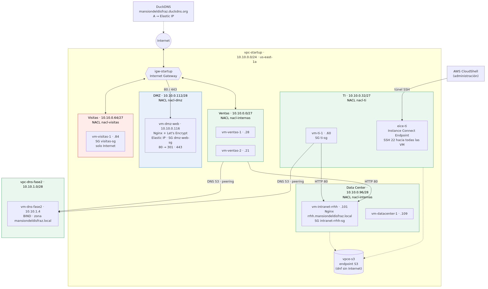

# Proyecto final de Redes (CC3067): Mansión del Disfraz en AWS

Red de una startup desplegada en AWS (`us-east-1`) con scripts para CloudShell.

- **Fase 1:** VPC `10.10.0.0/24` segmentada en Ventas, TI, Visitas y Data Center.
- **Fase 2:** DNS interno, intranet de RRHH, reglas de firewall, DMZ con web pública HTTPS, aislamiento de Visitas y hardening de todas las instancias.



## Orden de ejecución (CloudShell)

```bash
git clone https://github.com/melisadmendizabal/redes_proyecto2.git && cd redes_proyecto2

# Fase 1: VPC, subredes, Internet Gateway, nacl-internas y VM de prueba
bash deploy-aws.sh

# Fase 2, parte 1: DNS interno (BIND). La VPC 10.10.1.0/28, el peering y la VM
# se crearon desde la consola; configurar-dns-fase2.sh es el user data de la VM.
#   ver cloud_results/dns-fase2.md

# Fase 2, parte 2: intranet de RRHH
bash desplegar-intranet-fase2.sh
bash pruebas-intranet-fase2.sh | tee ~/evidencia-aws/pruebas-intranet-fase2.log

# Fase 2, parte 3: TI llega a todo, nadie llega a TI (ti-sg, nacl-ti, eice-ti)
bash reglas-internas-fase2.sh
bash pruebas-reglas-fase2.sh | tee ~/evidencia-aws/pruebas-reglas-fase2.log

# Fase 2, parte 4: DMZ y web publica con Let's Encrypt
bash desplegar-dmz-fase2.sh                       # apuntar DuckDNS a la Elastic IP que imprime
bash habilitar-https-fase2.sh mansiondeldisfraz.duckdns.org
bash pruebas-dmz-fase2.sh mansiondeldisfraz.duckdns.org | tee ~/evidencia-aws/pruebas-dmz-fase2.log

# Fase 2, parte 5: Visitas solo Internet + hardening
bash escanear-puertos-fase2.sh antes
bash reglas-visitas-fase2.sh
SOLO_VISITAS=1 bash pruebas-visitas-hardening-fase2.sh | tee ~/evidencia-aws/pruebas-visitas-nacl.log
bash aplicar-hardening-fase2.sh | tee ~/evidencia-aws/hardening-fase2.log
bash escanear-puertos-fase2.sh despues
bash pruebas-visitas-hardening-fase2.sh | tee ~/evidencia-aws/pruebas-visitas-hardening-fase2.log

# Limpieza (despues de la presentacion)
bash limpiar-dns-fase2.sh     # VPC del DNS y peering
bash limpiar-aws.sh           # todo vpc-startup, incluida la Elastic IP
```

Las VM no aceptan SSH desde Internet. Para entrar a cualquiera, se pasa por el endpoint de TI:

```bash
ssh -i ~/proyecto-key.pem -o ProxyCommand='aws ec2-instance-connect open-tunnel --instance-id %h' ec2-user@<instance-id>
```

## Archivos

| Parte | Scripts | Documentación y evidencia (`cloud_results/`) |
|---|---|---|
| Fase 1 | `deploy-aws.sh`, `pruebas-aws.sh`, `limpiar-aws.sh` | `interpretacion.md`, `*.json`, `capturas/` |
| 1. DNS interno | `configurar-dns-fase2.sh` | `dns-fase2.md` |
| 2. Intranet RRHH | `desplegar-intranet-fase2.sh`, `configurar-intranet-fase2.sh`, `pruebas-intranet-fase2.sh` | `intranet-fase2.md`, `capturas-intranet/` |
| 3. Reglas internas | `reglas-internas-fase2.sh`, `pruebas-reglas-fase2.sh` | `reglas-internas-fase2.md` |
| 4. DMZ y web pública | `desplegar-dmz-fase2.sh`, `configurar-web-publica-fase2.sh`, `habilitar-https-fase2.sh`, `pruebas-dmz-fase2.sh`, `limpiar-dmz-fase2.sh` | `dmz-fase2.md`, `capturas-dmz/` |
| 5. Visitas y hardening | `reglas-visitas-fase2.sh`, `hardening-fase2.sh`, `aplicar-hardening-fase2.sh`, `escanear-puertos-fase2.sh`, `pruebas-visitas-hardening-fase2.sh`, `limpiar-dns-fase2.sh` | `visitas-hardening-fase2.md` |
| Informe | — | `informe-fase2-seccion5-y-cierre.md`, `diagrama-red-fase2.mmd` / `.png` |

Los scripts deben tener finales de línea LF. Si se copian desde Windows, se convierten con `sed -i 's/\r$//' *.sh`.
