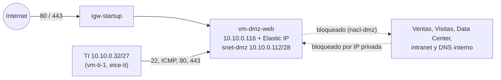

# DMZ y servidor web público — Fase 2

Región `us-east-1`, VPC `vpc-startup` (`10.10.0.0/24`). La DMZ es la subred nueva `snet-dmz` (`10.10.0.112/28`), en la misma zona que TI. Ahí está `vm-dmz-web`, con Amazon Linux 2023 y Nginx, que publica el sitio de Ventas para los clientes. Su IP privada fija es `10.10.0.116` y su IP pública es una Elastic IP. El dominio público `mansiondeldisfraz.duckdns.org` (DuckDNS) apunta a esa Elastic IP. El sitio usa un certificado de Let's Encrypt y fuerza la redirección de HTTP a HTTPS.

## Archivos

| Archivo | Para qué sirve |
|---|---|
| `desplegar-dmz-fase2.sh` | Se ejecuta en CloudShell. Crea la subred, `rt-dmz`, `nacl-dmz`, `dmz-web-sg`, la Elastic IP y la instancia. Exporta la configuración a `~/evidencia-aws/dmz-*.json`. |
| `configurar-web-publica-fase2.sh` | Configura la VM. Sin argumentos es el user data: instala Nginx y publica el sitio por HTTP. Con `--https <dominio>` obtiene el certificado y deja la configuración final. |
| `habilitar-https-fase2.sh` | Se ejecuta en CloudShell. Verifica que el dominio apunte a la Elastic IP, ejecuta el modo `--https` dentro de la VM y comprueba la redirección y el certificado desde Internet. |
| `pruebas-dmz-fase2.sh` | Se ejecuta en CloudShell. Prueba el tráfico permitido y el bloqueado desde Internet, desde la red interna y desde la DMZ. |
| `limpiar-dmz-fase2.sh` | Borra solo los recursos de la DMZ. `limpiar-aws.sh` ahora también libera las Elastic IP del proyecto. |

Orden de ejecución en CloudShell:

```bash
bash desplegar-dmz-fase2.sh                                   # imprime la Elastic IP
# en https://www.duckdns.org: apuntar el subdominio a la Elastic IP
bash habilitar-https-fase2.sh mansiondeldisfraz.duckdns.org
bash pruebas-dmz-fase2.sh mansiondeldisfraz.duckdns.org | tee ~/evidencia-aws/pruebas-dmz-fase2.log
```

## Diseño



- **Subred y rutas.** `rt-dmz` tiene la ruta local y `0.0.0.0/0` hacia `igw-startup`. No tiene ruta al peering del DNS interno: el servidor público usa el DNS de AWS y no conoce la zona `.local`. La subred no asigna IP pública automática; la única IP pública es la Elastic IP, que no cambia aunque la instancia se reinicie.
- **Quién llega a la DMZ.** Desde la red interna, solo TI (administración y pruebas). Ventas y Visitas llegan a la web por su dominio público, saliendo por el Internet Gateway como cualquier cliente de Internet. Por eso Visitas sigue teniendo "solo Internet". TI y Data Center no tienen ruta a Internet.
- **Qué inicia la DMZ.** Nada hacia la red interna. Hacia Internet solo sale HTTPS (443), que necesitan `dnf` y Let's Encrypt. Si el servidor web se viera comprometido, no podría usarse para atacar la intranet ni a TI.
- **Costo.** Se usan Security Groups y Network ACL, que no tienen costo. AWS Network Firewall (~US$0.395/h) y un NAT Gateway (~US$0.045/h) no hacen falta en este diseño.

### Network ACL `nacl-dmz` (sin estado, asociada a `snet-dmz`)

| Regla | Dirección | Acción | Protocolo | Origen/destino | Puertos | Motivo |
|---|---|---|---|---|---|---|
| 100 | Entrada | allow | TCP | `10.10.0.32/27` TI | 22 | SSH de administración (incluye `eice-ti`) |
| 110 | Entrada | allow | ICMP | `10.10.0.32/27` TI | todos | Ping desde TI |
| 120 | Entrada | allow | TCP | `10.10.0.32/27` TI | 80 | Pruebas HTTP desde TI |
| 130 | Entrada | allow | TCP | `10.10.0.32/27` TI | 443 | Pruebas HTTPS desde TI |
| 190 | Entrada | **deny** | todos | `10.10.0.0/24` | — | Ventas, Visitas y Data Center no entran por red privada |
| 200 | Entrada | **deny** | todos | `10.10.1.0/28` | — | VPC del DNS interno |
| 300 | Entrada | allow | TCP | `0.0.0.0/0` | 80 | HTTP público: redirección y reto de Let's Encrypt |
| 310 | Entrada | allow | TCP | `0.0.0.0/0` | 443 | HTTPS público |
| 320 | Entrada | allow | TCP | `0.0.0.0/0` | 1024-65535 | Respuestas a lo que descarga el servidor (`dnf`, Let's Encrypt) |
| 100 | Salida | allow | TCP | `10.10.0.32/27` TI | 1024-65535 | Respuestas hacia TI |
| 110 | Salida | allow | ICMP | `10.10.0.32/27` TI | todos | Respuesta de ping hacia TI |
| 190 | Salida | **deny** | todos | `10.10.0.0/24` | — | La DMZ no inicia nada hacia la red interna |
| 200 | Salida | **deny** | todos | `10.10.1.0/28` | — | Ni hacia la VPC del DNS |
| 300 | Salida | allow | TCP | `0.0.0.0/0` | 443 | HTTPS saliente |
| 310 | Salida | allow | TCP | `0.0.0.0/0` | 1024-65535 | Respuestas a los clientes web |

Las reglas de TI van antes que la 190 porque la NACL se evalúa de menor a mayor y se detiene en la primera que coincide. Como no tiene estado, cada entrada permitida necesita su salida para la respuesta (puertos efímeros 1024-65535).

### Security Group `dmz-web-sg` (con estado, asignado a `vm-dmz-web`)

| Dirección | Protocolo | Puerto | Origen/destino | Motivo |
|---|---|---|---|---|
| Entrada | TCP | 80 | `0.0.0.0/0` | Redirección a HTTPS y renovación del certificado |
| Entrada | TCP | 443 | `0.0.0.0/0` | Sitio público |
| Entrada | TCP | 22 | `10.10.0.32/27` TI | Administración por `eice-ti` |
| Entrada | ICMP | todos | `10.10.0.32/27` TI | Ping desde TI |
| Salida | TCP | 443 | `0.0.0.0/0` | `dnf` y Let's Encrypt. Se quitó la regla por defecto "todo hacia todos" |

AWS no filtra con Security Groups ni con NACL el tráfico hacia el DNS de la VPC (`10.10.0.2`), los metadatos de la instancia ni Amazon Time Sync. Por eso basta con permitir la salida 443.

### Servidor web (`configurar-web-publica-fase2.sh`)

- **Base:** el mismo `nginx.conf` de la intranet. Incluye `server_tokens off`, que oculta la versión de Nginx. La instancia exige IMDSv2 y usa `CpuCredits=standard`, que limita la CPU en vez de cobrar créditos extra.
- **Fase HTTP (user data):** publica `/usr/share/nginx/web-publica/index.html` en el puerto 80 y atiende el reto HTTP-01 desde `/var/www/letsencrypt`.
- **Fase HTTPS:** `certbot certonly --webroot` primero contra el entorno de pruebas (`--dry-run`) y después la emisión real. certbot 2.6 viene en los repositorios de Amazon Linux 2023.
- **Configuración final (`/etc/nginx/conf.d/web-publica.conf`):**
  - El puerto 80 responde `301` hacia `https://mansiondeldisfraz.duckdns.org`, salvo `/.well-known/acme-challenge/`, que sigue por HTTP para renovar.
  - Un `default_server` en 443 con `ssl_reject_handshake on` rechaza las conexiones por IP directa o con otro nombre.
  - El sitio acepta solo TLS 1.2 y 1.3, con cifrados ECDHE. Envía HSTS (`max-age=31536000`), `Content-Security-Policy`, `X-Frame-Options`, `X-Content-Type-Options` y `Referrer-Policy`.
- **Renovación:** `certbot-renew.timer` del paquete se ejecuta dos veces al día. El hook `/etc/letsencrypt/renewal-hooks/deploy/recargar-nginx.sh` recarga Nginx al renovar.

Antes de desplegar, el script se probó en un contenedor `amazonlinux:2023` con un certificado autofirmado. Resultados:
- HTTP 200 en la fase 1 y reto ACME servido.
- 301 hacia el dominio, HTTPS 200 y las cabeceras de seguridad presentes.
- Handshake rechazado por IP y por SNI ajeno.
- TLS 1.1 rechazado y TLS 1.3 aceptado.
- `shellcheck` sin advertencias.

## Matriz de conectividad con la DMZ

| Origen ↓ / Destino → | DMZ por IP privada | Web por dominio público | Red interna |
|---|---|---|---|
| **TI** | ✔ 22, ICMP, 80, 443 | sin ruta a Internet | ✔ (reglas de la persona 3) |
| **Ventas** | ✘ `nacl-dmz` 190 | ✔ HTTPS por Internet | — |
| **Visitas** | ✘ `nacl-dmz` 190 | ✔ HTTPS por Internet | ✘ |
| **Data Center** | ✘ `nacl-dmz` 190 | sin ruta a Internet | — |
| **DMZ** | — | — | ✘ `nacl-dmz` 190 (y SG de destino) |
| **Internet** | — | ✔ 80 → 301, 443 | ✘ |

## Pruebas (`pruebas-dmz-fase2.sh`)

| # | Origen → destino | Esperado |
|---|---|---|
| 1 | Configuración de `snet-dmz`, `rt-dmz`, `nacl-dmz` y `dmz-web-sg` | Tablas |
| 2 | `vm-dmz-web`: `nginx -t`, timer de renovación, `ss -tulpn` y certificado | En TCP solo escuchan 22, 80 y 443 |
| 3 | Internet: DNS de `mansiondeldisfraz.duckdns.org` | Coincide con la Elastic IP |
| 4 | Internet → `http://` | `301` hacia `https://` |
| 5 | Internet → `https://` | `200`, certificado válido de Let's Encrypt, TLS 1.3 |
| 6 | Internet → IP directa | HTTP `301` al dominio; HTTPS rechazado |
| 7 | Internet → TCP 22 | Bloqueado |
| 8–9 | `vm-ti-1` → DMZ (ping, 22, 80, 443) | Funciona |
| 10 | `vm-ventas-1` → DMZ por IP privada | Bloqueado |
| 11 | `vm-ventas-1` → `https://` por dominio | `200` |
| 12 | `vm-visitas-1` → DMZ por IP privada | Bloqueado |
| 13 | `vm-visitas-1` → `https://` por dominio | `200` |
| 14 | `vm-datacenter-1` → DMZ por IP privada | Bloqueado |
| 15–17 | `vm-dmz-web` → `vm-ti-1`, `vm-ventas-1`, `vm-datacenter-1` | Bloqueado |
| 18 | `vm-dmz-web` → intranet `10.10.0.101` | Bloqueado |
| 19 | `vm-dmz-web` → DNS interno `10.10.1.4` | No resuelve, TCP 53 bloqueado |
| 20 | `vm-dmz-web` → Internet | HTTPS sí (muestra la Elastic IP); HTTP 80 bloqueado |

La prueba 6 de `pruebas-reglas-fase2.sh` (persona 3), `vm-ti-1` → DMZ puerto 80, ahora aplica y debe funcionar. La prueba 8 de este script ya la cubre.

### Resultados de la ejecución (14 de noviembre de 2026)

`desplegar-dmz-fase2.sh` creó estos recursos en `vpc-02251b0b1ccc6414f` ([registro](dmz-despliegue.log)):
- `snet-dmz` (`subnet-09af77442308c35b2`)
- `rt-dmz` (`rtb-05485a69996d5a396`, con salida por `igw-09a71c300f15a3667`)
- `nacl-dmz` (`acl-0cebd51f250175bdd`)
- `dmz-web-sg` (`sg-08c666b480b3ad6af`)
- la Elastic IP `32.200.48.146` (`eipalloc-053f4fbb2d1ce3bbf`)
- `vm-dmz-web` (`i-01e284ea226a31eec`, `10.10.0.116`)

La configuración exportada está en los `dmz-*.json` de esta carpeta.

`habilitar-https-fase2.sh` instaló certbot 2.6.0 desde los repositorios de AL2023 ([registro](dmz-https.log)). La prueba contra staging salió bien y luego se emitió el certificado real:
- Sujeto: `CN=mansiondeldisfraz.duckdns.org`.
- Emisor: `Let's Encrypt, CN=YE2`.
- Vigencia: del 14-11-2026 al 12-02-2027.
- Clave ECDSA.

La conexión negocia TLS 1.3 (`TLS_AES_256_GCM_SHA384`, x25519). Las 20 pruebas dieron el resultado esperado ([registro completo](pruebas-dmz-fase2.log)):

| Prueba | Origen → destino | Resultado |
|---|---|---|
| 1 | Configuración | Tablas de `snet-dmz`, `rt-dmz`, `nacl-dmz` y `dmz-web-sg` |
| 2 | `vm-dmz-web` | `nginx -t` correcto y `certbot-renew.timer` programado. En TCP solo escuchan sshd (22) y nginx (80/443). En UDP solo el cliente DHCP de `systemd-networkd` (68 y 546) y `chronyd` en localhost (323) |
| 3 | Internet: DNS | `mansiondeldisfraz.duckdns.org` → `32.200.48.146`, igual a la Elastic IP |
| 4 | Internet → `http://` | `301 Moved Permanently`, `Location: https://mansiondeldisfraz.duckdns.org/` |
| 5 | Internet → `https://` | `200`, certificado válido (`ssl_verify_result=0`), HSTS, CSP, `X-Frame-Options`; `Server: nginx` sin versión |
| 6 | Internet → IP directa | HTTP `301` al dominio; HTTPS rechazado (`tlsv1 unrecognized name`) |
| 7 | Internet → TCP 22 | Sin conexión |
| 8–9 | `vm-ti-1` → DMZ | Ping 0 % de pérdida; TCP 22, 80 y 443 abiertos; HTTP `301` y HTTPS `200` por IP privada |
| 10 | `vm-ventas-1` → DMZ (privada) | 100 % de pérdida; 22, 80 y 443 sin conexión |
| 11 | `vm-ventas-1` → dominio | HTTPS `200` |
| 12 | `vm-visitas-1` → DMZ (privada) | 100 % de pérdida; 22, 80 y 443 sin conexión |
| 13 | `vm-visitas-1` → dominio | HTTPS `200` |
| 14 | `vm-datacenter-1` → DMZ (privada) | 100 % de pérdida; 22, 80 y 443 sin conexión |
| 15–17 | `vm-dmz-web` → TI, Ventas, Data Center | 100 % de pérdida; TCP 22 sin conexión |
| 18 | `vm-dmz-web` → intranet | Timeout, HTTP `000` |
| 19 | `vm-dmz-web` → DNS interno | `rrhh.mansiondeldisfraz.local` no resuelve; TCP 53 sin conexión |
| 20 | `vm-dmz-web` → Internet | HTTPS sale y `checkip` devuelve `32.200.48.146`; HTTP 80 saliente bloqueado |

Las pruebas 11 y 13 confirman cómo funciona el Internet Gateway: Ventas y Visitas llegan a la web pública por la Elastic IP con su propia IP pública. Por eso la regla 190 de `nacl-dmz`, que niega `10.10.0.0/24`, no las afecta. Las pruebas 10 y 12 muestran que, por red privada, esa misma regla sí las bloquea.

Por fuera de AWS, desde una conexión residencial, se repitieron las pruebas de Internet con el mismo resultado:
- `301` a HTTPS y `200` con TLS 1.3.
- Rechazo por IP y rechazo de TLS 1.1.
- Puerto 22 cerrado.

En ese momento la cuenta tenía el plan gratuito (`FREE`) con US$79.68 de créditos.

Capturas en [`capturas-dmz/`](capturas-dmz/): el registro de DuckDNS apuntando a la Elastic IP y el sitio en el navegador con conexión segura.

## Costos

| Recurso | Costo aproximado |
|---|---|
| `vm-dmz-web` (`t3.micro`) | US$0.0104/h |
| Elastic IP (se cobra en uso o sin usar) | US$0.005/h |
| Disco gp3 de 8 GB | ~US$0.64/mes |
| Subred, tabla de rutas, NACL, Security Group, EICE, Let's Encrypt, DuckDNS | Sin costo |

En total son unos US$0.39 al día, que salen de la capa gratuita o de los créditos de la cuenta mientras haya. Después de la presentación, ejecutar `bash limpiar-dmz-fase2.sh`. Detener la instancia no detiene el cobro de la Elastic IP.

## Notas para el resto del equipo

- **Entrar a `vm-dmz-web`:** desde CloudShell, por el endpoint de TI.

  ```bash
  ssh -i ~/proyecto-key.pem -o ProxyCommand='aws ec2-instance-connect open-tunnel --instance-id %h' ec2-user@<instance-id de vm-dmz-web>
  ```

- **Hardening (persona 5):** en `vm-dmz-web` deben quedar abiertos solo el 22 (sshd), el 80 y el 443 (nginx). Se verifica con `sudo ss -tulpn`; la salida "antes" está en la prueba 2 de `pruebas-dmz-fase2.log`. Ahí también aparecen el cliente DHCP (UDP 68 y 546) y `chronyd` en localhost: son normales y no hay que cerrarlos. `sshd` escucha en IPv4 e IPv6, pero la VPC no tiene IPv6.
  - Si se activa un firewall en el sistema operativo, el 80 y el 443 deben quedar abiertos a todo Internet, y el 22 solo para `10.10.0.32/27`.
  - No cerrar el 80: lo usa Let's Encrypt para renovar el certificado.
  - No bloquear la salida 443: la necesitan `dnf` y certbot.
- **Visitas (persona 5):** si se crea una NACL para Visitas, debe permitir la salida TCP 80/443 y la entrada de puertos efímeros desde `0.0.0.0/0`, para que Visitas llegue a Internet y a la web pública. También debe dejar salir las respuestas hacia `10.10.0.32/27` (ver `reglas-internas-fase2.md`). La DMZ ya bloquea a Visitas por red privada.
- **Después de cambiar reglas:** volver a ejecutar `pruebas-dmz-fase2.sh` para confirmar que la web sigue funcionando.
- **Limpieza:** `limpiar-dmz-fase2.sh` borra solo la DMZ. `limpiar-aws.sh` termina las instancias y ahora también libera las Elastic IP. Una Elastic IP sin liberar sigue cobrando aunque la instancia ya no exista.
