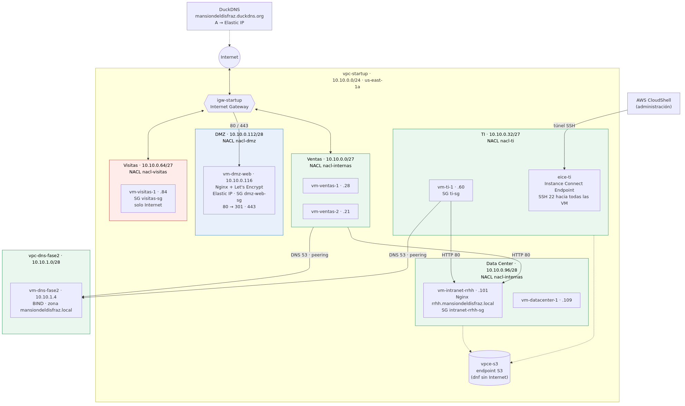

# Informe Fase 2 — Sección 5 y cierre
---

## Diagrama de red actualizado

El diagrama muestra la VPC `vpc-startup` (`10.10.0.0/24`) con las cuatro subredes de la Fase 1 y la DMZ nueva (`10.10.0.112/28`). También muestra la VPC del DNS interno (`10.10.1.0/28`), conectada por peering. Cada subred lleva su firewall de subred (Network ACL) y cada servidor, su firewall de instancia (Security Group). Los servicios nuevos son el DNS interno con BIND, la intranet de RRHH y la web pública con HTTPS. La administración entra por el EC2 Instance Connect Endpoint de TI (`eice-ti`).

| Subred / VPC | Bloque | Firewall de subred (NACL) | Instancias y servicios |
|---|---|---|---|
| Ventas | `10.10.0.0/27` | `nacl-internas` | `vm-ventas-1` (.28), `vm-ventas-2` (.21) |
| TI | `10.10.0.32/27` | `nacl-ti` | `vm-ti-1` (.60), endpoint `eice-ti` |
| Visitas | `10.10.0.64/27` | `nacl-visitas` | `vm-visitas-1` (.84) |
| Data Center | `10.10.0.96/28` | `nacl-internas` | `vm-intranet-rrhh` (.101, Nginx), `vm-datacenter-1` (.109) |
| DMZ | `10.10.0.112/28` | `nacl-dmz` | `vm-dmz-web` (.116 + Elastic IP, Nginx + Let's Encrypt) |
| VPC del DNS | `10.10.1.0/28` | por defecto | `vm-dns-fase2` (10.10.1.4, BIND) |

## 5. Visitas y hardening

### 5.1 Visitas: acceso solo a Internet

En la Fase 1, Visitas quedaba aislada solo porque los destinos rechazaban su tráfico (regla 50 de `nacl-internas`). La subred en sí permitía todo. En la Fase 2 el control se puso en la propia subred de Visitas, con dos piezas:

- **Network ACL `nacl-visitas`.** Firewall de subred, sin estado. Permite todo lo que viene de TI (regla 100). Después niega todo el espacio privado RFC 1918 (`10.0.0.0/8`, `172.16.0.0/12`, `192.168.0.0/16`), de entrada y de salida, y al final permite Internet (`0.0.0.0/0`). Como la NACL no tiene estado, se permiten explícitamente las respuestas: puertos efímeros 1024-65535 e ICMP de respuesta y de error.
- **Security Group `visitas-sg`.** Firewall de instancia, con estado. Solo acepta SSH e ICMP desde TI, y ya no SSH desde Internet. La salida queda abierta, porque un Security Group no puede negar: la restricción hacia lo privado la hace la NACL.

Visitas sigue resolviendo nombres públicos porque AWS no filtra con NACL el tráfico hacia su DNS (`10.10.0.2`). Llega a la web pública como cualquier cliente: sale por el Internet Gateway con su IP pública y entra a la DMZ por la Elastic IP. Por IP privada no llega a la DMZ.

### 5.2 Hardening de las instancias

Se aplicó en dos niveles a las ocho VM del proyecto.

**En la nube (Security Groups).** Se cerraron los puertos que ya no hacían falta. `startup-sg` dejó de aceptar SSH desde Internet y desde toda la VPC, y ahora solo lo acepta desde TI. `intranet-rrhh-sg` dejó de aceptar SSH desde Ventas, que era el salto de la Fase 1. Toda la administración pasa por el endpoint `eice-ti`, ubicado en la subred de TI.

**En el sistema operativo (`hardening-fase2.sh`).**

- *SSH:* solo autenticación por llave pública, sin root ni contraseñas, máximo tres intentos, solo el usuario `ec2-user`, solo IPv4 y sin X11 ni reenvío de puertos. Solo `vm-ti-1` reenvía conexiones, porque es la entrada a la VPC del DNS.
- *Firewall del SO (nftables):* la entrada se descarta por defecto. Cada VM acepta solo los puertos de su servicio y desde los mismos orígenes que su Security Group: SSH desde TI en todas, HTTP 80 en la intranet, 80/443 en la DMZ y 53 en el DNS. En Visitas y la DMZ, la salida hacia redes privadas también se rechaza.
- *Servicios:* se deshabilitan los servicios de red sin uso. Se apagan LLMNR/mDNS (puerto 5355) y el puerto de control de `chronyd` (323).
- *Kernel:* sin ICMP redirects ni source routing, y con SYN cookies.

Para no quedar fuera de una VM por un error de configuración, el script programa una reversión automática en cinco minutos. Esa reversión solo se cancela si una conexión SSH nueva confirma que el acceso sigue funcionando.

### 5.3 Consideraciones del firewall en AWS

- **Dos capas con comportamiento distinto.** El Security Group se aplica a la interfaz de la instancia, tiene estado y solo admite reglas `allow`. La Network ACL se aplica a la subred, no tiene estado y admite `allow` y `deny`, que se evalúan por número de menor a mayor. Se usaron las dos: el Security Group como firewall principal y la NACL para las negaciones que el Security Group no puede expresar, como "Visitas: todo menos lo privado" o "nadie hacia TI".
- **Puertos efímeros.** Como la NACL no tiene estado, cada flujo permitido necesita su regla de vuelta (1024-65535). Si falta, la conexión se abre pero la respuesta se pierde.
- **Tráfico que AWS no filtra.** El DNS de la VPC (`.2`), DHCP, los metadatos de la instancia y Amazon Time Sync no pasan por las NACL ni por los Security Groups. Por eso se puede negar `10.0.0.0/8` en una NACL sin romper la resolución de nombres.
- **Costo.** Se descartó AWS Network Firewall (~US$0.395/h) y NAT Gateway (~US$0.045/h). Security Groups, NACL, el Instance Connect Endpoint y el endpoint gateway de S3 no tienen costo, y cubren los requisitos.
- **Un Instance Connect Endpoint por VPC.** Se ubicó en TI para que toda administración salga con IP de TI, la única subred que llega a todas.
- **Defensa en profundidad.** Una conexión de Visitas hacia la red interna tendría que pasar cinco controles: el firewall del SO de Visitas, `nacl-visitas`, la NACL del destino, el Security Group del destino y el firewall del SO del destino.

## Tabla de servicios por integrante

| Integrante | Servicios / configuraciones implementadas | Tiempo estimado |
|---|---|---|
| Daniel Estrada | DNS interno: VM con BIND, zona `mansiondeldisfraz.local`, registro `rrhh`, VPC `vpc-dns-fase2` con peering y clientes con `systemd-resolved` | 3h |
| André Pivaral | Intranet de RRHH: Nginx en Data Center, virtual host `rrhh`, página HTML, endpoint de S3 y `intranet-rrhh-sg` | 4h |
| Melisa Mendizabal | Reglas internas: `ti-sg`, `nacl-ti`, endpoint `eice-ti`; TI llega a todo y nadie llega a TI; la intranet es accesible excepto desde Visitas | 4h |
| Juan Menendez | DMZ y web pública: `snet-dmz`, `nacl-dmz`, `dmz-web-sg`, Elastic IP, DuckDNS, HTTPS con Let's Encrypt y redirección HTTP→HTTPS | 3h |
| Renato Rojas | Visitas (`visitas-sg`, `nacl-visitas`) y hardening de las 8 instancias (Security Groups, SSH, nftables, servicios, sysctl), escaneo nmap, pruebas automáticas y limpieza del DNS | 4h |

## Archivos de configuración utilizados

Todos están en el repositorio: https://github.com/melisadmendizabal/redes_proyecto2. El orden de ejecución está en `README.md`.

| Parte | Scripts | Evidencia en `cloud_results/` |
|---|---|---|
| Fase 1 | `deploy-aws.sh`, `pruebas-aws.sh`, `limpiar-aws.sh` | `interpretacion.md`, `*.json`, `capturas/` |
| DNS interno | `configurar-dns-fase2.sh` | `dns-fase2.md` |
| Intranet | `desplegar-intranet-fase2.sh`, `configurar-intranet-fase2.sh`, `pruebas-intranet-fase2.sh` | `intranet-fase2.md`, `capturas-intranet/` |
| Reglas internas | `reglas-internas-fase2.sh`, `pruebas-reglas-fase2.sh` | `reglas-internas-fase2.md`, `reglas-*.json` |
| DMZ | `desplegar-dmz-fase2.sh`, `configurar-web-publica-fase2.sh`, `habilitar-https-fase2.sh`, `pruebas-dmz-fase2.sh`, `limpiar-dmz-fase2.sh` | `dmz-fase2.md`, `dmz-*.json`, `capturas-dmz/` |
| Visitas y hardening | `reglas-visitas-fase2.sh`, `hardening-fase2.sh`, `aplicar-hardening-fase2.sh`, `escanear-puertos-fase2.sh`, `pruebas-visitas-hardening-fase2.sh`, `limpiar-dns-fase2.sh` | `visitas-hardening-fase2.md`, `visitas-*.json`, `puertos-*.log` |

## Conclusiones

- La red quedó segmentada en cinco zonas con políticas distintas: Ventas, TI, Visitas, Data Center y DMZ. Cada política se aplica en la subred (NACL), en la instancia (Security Group) y en el sistema operativo (nftables). Ninguna capa depende sola de las demás.
- Los servicios internos (DNS e intranet) solo existen dentro de la red. Desde Internet no hay ruta, IP pública ni nombre que los alcance. El único servicio publicado está en la DMZ, que no puede iniciar conexiones hacia la red interna.
- Pasar la administración a un único punto de entrada en TI (`eice-ti`) permitió cerrar el SSH desde Internet en todas las instancias, sin bastión ni IP pública adicional.
- Las Network ACL no tienen estado. Fue la principal fuente de errores posibles: cada regla de entrada necesitó su regla de salida para las respuestas, y el orden numérico de las reglas define el resultado.
- Todo el escenario se despliega, se prueba y se elimina con scripts. Las pruebas comparan el resultado obtenido con el esperado, lo que hace repetible la verificación del escenario completo.
